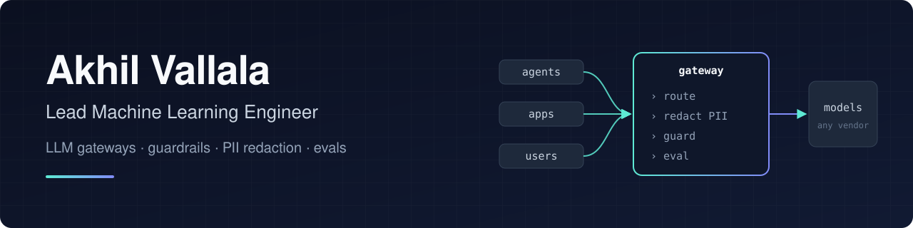

  

  
  
  
  
  

### I build the layer between your agents and the models

Gateways that route each call to the cheapest model that can handle it, guardrails that catch PII before it leaves the building, and the evals that prove both actually work.

- **Now:** Lead Machine Learning Engineer at **Blocsmith**, the team behind MoatDrop, a PII/PHI redaction platform. I own the document-extraction and Q&A engine on Gemini and Claude: context caching, redaction, RAG evaluation, and an MCP server for Claude Desktop, Cursor and Claude Code.
- **Before:** ML engineering at AventuSoft and Haus Llama, and data engineering at Accenture and Infosys on Azure, Databricks and Spark.
- **Education:** MS in Data Science, Florida Atlantic University (3.95 GPA). Second author of an NSF-funded paper in IEEE Transactions on Computational Social Systems.
- **Lately:** won ITCHATHON in San Francisco with AdPilot, an AI ad assistant for independent wealth managers, and shipped AgentShield in a day at the SF Tech Week hackathon.

### Featured work

| Project | What it is | Proof |
|:--|:--|:--|
| [**Conduit**](https://github.com/Akhilvallala1/conduit-ai-gateway) | Proxy-first AI gateway. Every model call goes through one OpenAI-compatible API; a two-stage complexity router escalates only the ambiguous cases. | **50.8%** lower cost vs all-Opus routing · **88.6%** router tier agreement · **0%** injection false positives |
| [**AgentShield**](https://github.com/Akhilvallala1/agentshield) | PII guardrail for agent-to-agent traffic that writes its own rules: regex + Presidio inline, an LLM auditor offline, new rules gated on precision/recall before they hot-load. | Built in one day · 53 tests · [demo video](https://youtu.be/rxwgwG6DUzY) |
| [**StudyForge**](https://github.com/Akhilvallala1/studyforge) | Open-source, self-hosted adaptive learning platform. Turns a PDF, link or YouTube video into a course with quizzes and FSRS spaced repetition. | 800+ backend tests · runs on Claude or local models |
| [**Rival Radar**](https://github.com/Akhilvallala1/rival-radar) | Competitive intelligence for B2B SaaS. A LangGraph + Claude pipeline that turns competitor site changes into a weekly Slack brief. | [Live demo](https://rival-radar-247626835860.us-central1.run.app) · CI/CD to Cloud Run · brief in ~60s |
| [**tiny-physics**](https://github.com/Akhilvallala1/tiny-physics) | Master's thesis. LoRA and instruction tuning of SmolLM2 for on-device physics QA, shipped as quantized GGUF. | **+30%** on MMLU College Physics · 6,000+ synthetic QA pairs |

### Research

**Unpacking Generative AI in Education.** IEEE Transactions on Computational Social Systems, second author. NSF-funded study of how students and teachers talk about GenAI across ~15,000 posts and articles. [Paper](https://doi.org/10.1109/TCSS.2025.3630587) · [Data pipeline](https://github.com/Akhilvallala1/NSF-GenAI-Impact-on-the-Student-Project)

### Stack

  

  
  
  
  
  
  
  
  
  

---

  Hiring for LLM infrastructure, guardrails or applied AI? <a href="mailto:akhilvallalajs@gmail.com">Let's talk.</a>

